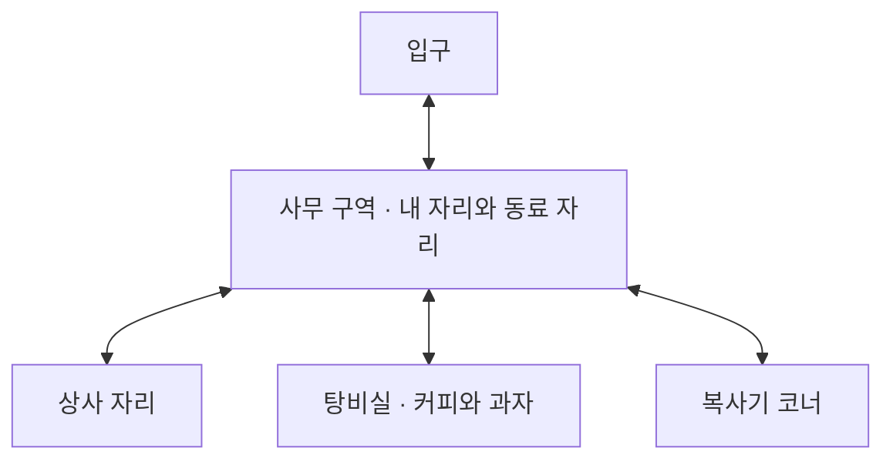

# 온라인 회사 첫 버전 설계안

작성일 2026년 11월 9일 · 상태 설계 검토용

직장인이 익숙한 사무실에서 일하는 척 딴짓하고, 상사를 골탕먹이고, 탕비실에서 빈둥거리며 짧게 웃고 나오는 웹 게임이다. 첫 버전은 이용자 한 명과 게임 속 상사·동료만 있는 회사로 만든다. 핵심 경험은 **“출근은 했는데, 내 마음대로 해도 되는 회사”**다.

사용자가 선택한 것은 혼자 플레이하는 방식과 네 가지 핵심 행동이다. 아래의 화면 방식, 인원, 세부 규칙과 수치는 이 설계안에서 제안하는 기본값이며, 설계 검토 후 제작 기준으로 확정한다. 제품명은 아직 정하지 않는다. 문서의 ‘온라인 회사’는 작업명이다.

# 1 목적과 설계 원칙

주요 이용자는 회사생활에 익숙한 직장인이다. 업무 사이 또는 퇴근 후 3~10분 정도 접속해도 재미를 느끼고, 더 머무르고 싶으면 자유롭게 놀 수 있어야 한다. 이 시간은 권장 경험 길이이며 제한 시간이 아니다.

- **현실감은 풍경과 상황에서 만든다.** 책상 칸막이, 업무 화면, 복사기, 사원증, 믹스커피, 짧은 상사의 말처럼 익숙한 단서가 중심이다.
- **일탈은 행동의 결과에서 만든다.** 딴짓이 들켜도 짧은 코미디로 끝난다. 상사를 때려도 반격이나 해고 없이 과장된 반응을 보여준다.
- **원하는 놀이를 바로 한다.** 무기와 장소는 처음부터 열려 있다. 출석, 레벨, 과제, 순위, 필수 튜토리얼로 행동을 막지 않는다.
- **가만히 있어도 회사가 움직인다.** 동료들은 타이핑하고 졸고 커피를 마신다. 이용자에게 계속 말을 걸거나 행동을 요구하지 않는다.

첫 방문에서 자신의 자리와 주요 행동을 쉽게 찾고, 설명 없이도 한 번의 행동과 결과를 이해하는 것이 성공 기준이다.

# 2 선택한 방식과 첫 공개 범위

| 검토한 방식 | 장점 | 추가 부담과 한계 | 결정 |
| --- | --- | --- | --- |
| 혼자 플레이하고 상사와 동료는 게임 캐릭터로 구성 | 언제 접속해도 회사가 움직이며 네 가지 놀이의 반응에 집중할 수 있음 | 다른 실제 이용자의 예상 밖 행동을 구경하는 재미는 없음 | 사용자 선택. 첫 버전으로 제작 |
| 실제 이용자가 같은 사무실에 함께 입장 | 말없이도 동료감과 함께 장난치는 재미가 생김 | 좌석 점유, 이동과 타격 공유, 연결 중단, 다른 사람의 놀이 방해까지 설계해야 함 | 후속 확장 후보 |

첫 공개에는 사무실 한 층, 이용자 캐릭터 한 명, 상사 한 명, 동료 세 명, 내 자리, 딴짓 세 가지, 타격 수단 세 가지, 커피와 간식 놀이를 포함한다. 로그인 없이 시작하고, 같은 브라우저에서는 이름·설정·소지 간식을 기억한다.

실시간 다른 이용자, 채팅, 대화 선택지, 음성 대화, 회원가입, 결제, 광고, 순위, 승진, 일일 과제, 여러 층, 본격적인 캐릭터 꾸미기는 이번 범위에서 제외한다. 동료와 상사의 짧은 자동 말풍선은 분위기 연출이며 대화 기능이 아니다.

# 3 화면과 공간

## 화면 방향

**위에서 비스듬히 내려다보는 3D 사무실**을 제안한다. 카메라는 이용자를 부드럽게 따라가며, 기본 각도는 고정하고 확대와 축소만 제공한다. 작은 공간에서 길을 찾기 쉽고 내 캐릭터와 상사의 반응을 함께 볼 수 있는 구도다.

공간은 회색 카펫, 밝은 칸막이, 형광등, 창문, 복사기처럼 실제 사무실을 연상시키고, 캐릭터는 큰 머리와 단순한 얼굴로 표정·동작이 잘 보이게 한다. 상사의 충격 반응은 만화적인 찌그러짐, 튕김, 회전, 흐트러진 넥타이로 표현한다. 구체적인 색상, 의상, 가구 형태는 시안에서 조정한다.

2D 그림 방식보다 공간감을 살리고, 자유로운 1인칭 카메라보다 길 찾기와 조작 부담을 줄이는 선택이다. 산사의 미술이나 캐릭터를 그대로 사용하지 않고 회사용 자산을 새로 만든다.

## 한 층의 구성

| 구역 | 배치와 내용 | 플레이 역할 |
| --- | --- | --- |
| 입구 | 화면 아래쪽 중앙, 출입문과 작은 사원증 단말기 | 처음 시작하는 위치. 내 자리가 바로 보임 |
| 사무 구역 | 중앙의 책상 여섯 개. 내 자리 하나, 동료 자리 셋, 빈 책상 둘 | 착석과 딴짓. 넓은 통로로 다른 구역과 연결 |
| 상사 구역 | 사무 구역 뒤쪽, 상사 책상과 회전의자 | 상사를 쉽게 찾는 기준점. 순찰 출발·복귀 위치 |
| 탕비실 | 오른쪽, 열린 출입구. 커피 머신, 정수기, 과자 선반, 작은 테이블 | 커피와 간식 놀이. 상사가 딴짓을 감시하지 않는 휴식 구역 |
| 복사기 코너 | 왼쪽 벽과 창가 | 동료의 일상 행동과 회사 소리를 만드는 배경 |

모든 구역은 한 화면 세계에 있고, 방을 옮길 때 로딩하지 않는다. 가구는 통과할 수 없고, 캐릭터끼리는 서로 길을 완전히 막지 않는다. 내 자리는 다른 캐릭터가 차지하지 않는다. 좁은 화면에서는 캐릭터 근처를 보여주고 주요 장소 바로가기 버튼으로 길 찾기를 돕는다.

아래는 구역 사이의 연결 관계다. 실제 치수와 평면 비율은 제작 시 통행과 화면 가독성을 보며 조정한다.

# 4 첫 방문과 자유로운 놀이 흐름

1. **입장 전:** 짧은 소개와 ‘출근하기’ 버튼. 이름은 기본값 ‘김사원’으로 바로 시작하거나 2~10자로 바꿀 수 있다. 시작 전 입력을 강제하지 않는다.
2. **입장 직후:** 입구에 등장하고 내 자리 위에 ‘내 자리’ 표시가 보인다. ‘바닥을 눌러 이동’과 ‘가까이 가서 행동’ 안내를 한 번만 보여준다.
3. **첫 30초:** 자리에 앉아 업무 화면과 주변 동료를 확인한다. 하단에 업무·쇼핑·게임·졸기 행동이 나타난다.
4. **첫 1~2분:** 딴짓 중 상사가 다가오면 ‘업무로 전환’ 버튼으로 숨기거나, 들켰을 때의 짧은 반응을 본다. 상사에게 가까이 가면 바로 펀치나 뿅망치를 사용할 수 있다.
5. **이후:** 탕비실에서 커피와 과자를 챙기고, 자리로 돌아가거나 상사를 다시 골탕먹인다. 어떤 순서로 놀아도 된다.

이는 첫 방문의 예상 흐름이다. 순서대로 완료해야 하는 퀘스트나 점수판은 없다. 어느 때든 입구의 ‘퇴근하기’로 시작 화면으로 돌아가거나 브라우저를 닫을 수 있다.

# 5 네 가지 핵심 놀이

## 내 자리에 앉기

자기 의자나 책상을 선택하면 가까이 걸어간다. 도착한 뒤 ‘앉기’ 버튼이나 E를 누르면 짧은 착석 동작을 보여준다. 앉으면 모니터가 켜지고 업무하는 손동작과 키보드 소리가 이어진다.

착석 중에는 ‘업무’, ‘쇼핑’, ‘게임’, ‘졸기’, ‘일어나기’를 선택한다. ‘의자 돌리기’는 짧은 추가 동작으로 제공하고, 끝나면 이전 행동으로 돌아온다. 간식이 있으면 앉아서 먹을 수 있다. 내 자리는 항상 사용 가능하며, 빈 책상은 첫 버전에서 배경으로 둔다.

## 업무 보는 척 딴짓하기

| 행동 | 이용자가 하는 일 | 화면과 캐릭터 반응 |
| --- | --- | --- |
| 업무 | 업무 버튼으로 전환 | 가상의 표 문서와 그럴듯한 타이핑. 실제 업무 수행은 없음 |
| 쇼핑 | 가상의 상품 카드를 넘기기 | 모니터에 쇼핑 화면. 결제나 외부 사이트 연결은 없음 |
| 게임 | 모니터 안의 작은 표적을 누르기 | 짧고 가벼운 미니게임. 승패·제한 시간·누적 경쟁 점수 없이 누를 때마다 반응 |
| 졸기 | 졸기 선택 후 느긋하게 머무르기 | 고개가 꾸벅이고 가끔 코를 곪. 다른 행동을 선택하면 즉시 깨어남 |

모니터 내용은 화면의 일부에 확대 표시하되 주변과 상사 접근 표시가 계속 보인다. ‘업무로 전환’은 딴짓 중 항상 같은 위치에 있고, PC에서는 스페이스 키로도 실행한다. 실제 브라우저 창을 숨기는 기능은 아니다.

**상사에게 들키는 규칙:** 상사가 순찰 중 내 자리 앞의 지정된 관찰 위치에 도착했을 때만 확인한다. 쇼핑·게임·졸기 중이면 ‘상사가 보고 있어요’ 표시와 2초의 여유가 생긴다. 이때 업무로 바꾸면 그냥 지나간다. 계속 딴짓하면 상사가 한마디 하고 캐릭터가 민망한 표정을 짓는 약 3초의 장면을 보여준다. 이후에는 이용자가 고른 행동을 계속할 수 있다.

들켜도 간식·진행·기능을 빼앗지 않는다. 다음 관찰까지 최소 30초를 두고, 탕비실·이동 중·타격 놀이 중에는 관찰하지 않는다. 대사 예시는 ‘그 창도 업무 자료인가?’와 ‘아, 시장 조사 중이었군.’이다. 대사는 화면을 막지 않는 말풍선으로 나온다.

## 상사 골탕먹이기

상사를 선택하면 가까이 걸어가고, 행동 범위에 들어오면 ‘펀치’, ‘뿅망치’, ‘서류 부채’를 사용할 수 있다. 세 가지 모두 처음부터 열어 둔다. 자동 접근만으로 공격하지 않으며, 이용자가 공격 버튼을 눌렀을 때 타격한다.

| 수단 | 손맛 | 상사 반응 | 초기 조정값 |
| --- | --- | --- | --- |
| 펀치 | 빠르게 반복해서 두들기기 | 상체가 흔들리고 조금씩 뒤로 밀림 | 약 0.3초 간격 |
| 뿅망치 | 묵직한 한 번과 경쾌한 소리 | 납작하게 움츠러들었다가 크게 튕김 | 약 0.7초 간격 |
| 서류 부채 | 빠른 휘두름과 종이 소리 | 넥타이가 날리고 몸이 반 바퀴 회전 | 약 0.5초 간격 |

타격은 누른 순간 한 번 처리한다. 버튼을 누르고 있다고 자동으로 반복하지 않는다. 도구별 짧은 준비 동작·명중 순간·후속 동작과 소리로 차이를 만든다. 마지막 타격 후 약 2초 동안 추가 타격이 없으면 상사가 옷매무새를 정돈하고 원래 행동으로 돌아간다. 체력·사망·반격·복수 추격은 없다.

연타할 때도 상사가 가구나 벽 안으로 들어가지 않도록 이동 폭을 제한한다. 타격 중에는 상사의 관찰과 잔소리를 중단하고, 복귀 뒤 최소 10초 동안 관찰하지 않는다. 같은 타격으로 말풍선과 효과음이 과도하게 겹치지 않도록 이전 반응을 정리한다. 소리를 꺼도 동작과 명중 효과로 결과가 분명해야 한다.

## 탕비실에서 시간 때우기

- **커피:** 커피 머신을 선택해 가까이 간 뒤 ‘커피 내리기’를 누르면 약 3초 동안 커피를 내린다. 완료되면 머그 한 잔을 들고 이동할 수 있다. ‘한 모금’으로 세 번 마시면 빈 잔이 되고, 탕비실에서 다시 채운다. 커피는 능력치나 속도를 바꾸지 않는다.
- **과자 쟁이기:** 과자 선반을 선택해 가까이 간 뒤 쿠키·초코바·크래커 중 하나의 ‘챙기기’를 누르면 주변을 살피고 주머니에 넣는다. 한 번에 하나씩, 총 여섯 개까지 챙길 수 있다. 과자는 계속 공급되며 다른 캐릭터와 물량을 경쟁하지 않는다.
- **몰래 먹기:** 이동 중 멈춰 서거나 자리에 앉아서 소지 간식을 먹는다. 먹을 때 포장 소리와 작은 동작을 보여주고 소지량이 하나 줄어든다. 커피잔을 들고 있을 때는 잠깐 내려두는 연출 뒤 다시 든다.
- **빈둥거리기:** 탕비실 의자에 앉거나 테이블에 기대서 머무를 수 있다. 동료도 가끔 커피를 마시러 와서 시간을 보낸다. 대화창과 답변 선택은 없다.

커피 내리기나 과자 챙기기는 이동 버튼 또는 취소로 중단할 수 있다. 완료 전에 취소하면 소지품이 늘지 않는다. 주머니가 가득 차면 ‘주머니가 이미 빵빵합니다’라고 알려주고, 간식을 먹으면 다시 챙길 수 있다.

# 6 회사가 살아 있게 만드는 캐릭터

| 캐릭터 | 평소 행동 | 이용자와의 관계 |
| --- | --- | --- |
| 상사 한 명 | 자기 자리에서 서류 보기 → 복사기 확인 → 사무 구역 순찰 → 내 자리 관찰 → 복귀 | 딴짓 관찰과 타격 놀이의 대상 |
| 동료 한 명 | 자기 자리에서 타이핑하다 잠깐 스트레칭 | 회사의 평범한 리듬을 보여줌 |
| 동료 한 명 | 꾸벅꾸벅 졸다가 깜짝 놀라 타이핑 | 이용자의 딴짓에 공감할 수 있는 장면 |
| 동료 한 명 | 커피 마시기, 복사기 앞에서 서성거리기, 자기 자리 복귀 | 공간을 오가며 사무실에 생기를 더함 |

동료는 공격 대상이 아니며 이용자에게 일을 시키지 않는다. 같은 동작을 동시에 시작하지 않도록 주기를 조금씩 다르게 한다. 사무 구역 동료가 상사 타격을 가까이서 보면 잠깐 놀라거나 웃는 반응을 보일 수 있다. 첫 버전에는 동료별 반응 하나만 둔다.

캐릭터의 행동은 미리 정한 규칙과 대사로 작동한다. 생성형 AI 대화나 외부 AI 호출은 사용하지 않는다. NPC는 실제 접속자처럼 표시하지 않는다.

상사 행동의 우선순위는 **타격 반응 → 정돈과 복귀 → 들킨 반응 → 관찰 → 순찰**이다. 새 타격이 들어오면 관찰 장면을 중단한다. 길이 막혀 일정 시간 이동하지 못하면 가까운 유효 위치에서 경로를 다시 잡고, 계속 실패하면 이용자와 겹치지 않는 자기 자리 주변으로 복귀한다.

# 7 조작과 화면 구성

PC와 휴대전화의 브라우저에서 같은 네 가지 놀이를 제공한다. PC를 기준으로 먼저 완성하고, 모바일 조작을 포함해 첫 공개를 검증한다. 휴대전화는 세로·가로 모두 이용 가능하며 가로 화면에서 공간이 더 넓게 보인다.

물건이나 상사를 선택하는 것은 접근과 대상 선택까지만 실행한다. 실제 착석·제조·획득·공격은 도착 후 행동 버튼을 눌렀을 때 실행한다. PC의 E는 화면에 표시된 기본 행동 하나를 실행하며, 공격은 전용 버튼으로 실행한다. 도착 전에는 행동 버튼을 비활성화하고, 이동을 취소하면 선택한 대상도 해제한다.

| 기능 | PC | 모바일 |
| --- | --- | --- |
| 이동 | 바닥 클릭 또는 WASD·방향키 | 바닥 탭 |
| 물건 사용 | 물건 클릭 후 가까이서 E 또는 행동 버튼 | 물건 탭 후 행동 버튼 |
| 업무로 전환 | 화면 버튼 또는 스페이스 | 화면 버튼 |
| 공격 | 선택된 도구의 공격 버튼 | 선택된 도구의 공격 버튼 |
| 카메라 거리 | 휠 또는 확대·축소 버튼 | 확대·축소 버튼 |
| 취소와 닫기 | Esc 또는 닫기 버튼 | 닫기 버튼 |

이름 입력과 설정을 조작하는 동안에는 이동·공격 단축키를 받지 않는다. 화면의 버튼을 눌렀을 때 바닥 이동도 동시에 발생하지 않도록 분리한다. 다른 행동을 선택하면 가능한 경우 현재 행동을 취소하고 전환한다. 간식 차감과 커피 모금 차감은 완료 시 한 번만 처리한다.

화면 상단에는 작업명, 이름, 소리, 설정만 작게 둔다. 아래쪽에는 현재 상황에서 가능한 행동을 표시한다. 소지품은 머그 상태와 간식 개수로 보여준다. 상사 접근 표시는 내 자리 근처에 짧게 나타난다. 조작 안내는 다시 볼 수 있지만 상시 튜토리얼 팝업은 띄우지 않는다.

모바일에서 버튼은 서로 겹치지 않는 충분한 터치 영역을 확보하고, 행동이 많으면 두 줄로 배치한다. 중요한 기능을 마우스를 올려야만 발견하게 만들지 않는다. 설정에는 소리, 화면 흔들림·과한 움직임 줄이기, 그래픽 품질을 제공한다. 운영체제의 움직임 줄이기 설정을 초기값에 반영한다.

# 8 소리와 저장

사무실 환경음은 낮은 볼륨의 키보드, 드문 전화벨, 복사기, 냉난방 소리로 구성한다. 타격·커피·포장지 소리는 행동 결과를 알려준다. 연속 타격 소리는 겹침 수와 최대 음량을 제한한다. 음악은 첫 버전 필수가 아니다.

첫 방문은 소리 끔으로 시작하고 ‘소리 켜기’를 제공한다. 이후에는 저장된 선택을 따르되 브라우저가 허용하는 이용자 입력 뒤에 재생한다. 탭이 뒤로 가면 소리와 게임 진행을 멈추고, 돌아왔을 때 멈춘 지점에서 이어 간다. 자리를 비운 동안 딴짓 적발이 쌓이지 않는다.

| 데이터 | 저장 여부 | 다시 접속했을 때 |
| --- | --- | --- |
| 표시 이름, 선택한 도구 | 저장 | 마지막 선택 복원 |
| 음량·움직임 줄이기·그래픽 설정 | 저장 | 마지막 설정 복원 |
| 간식 종류별 개수 | 저장 | 최대 여섯 개 범위로 복원 |
| 커피잔과 남은 모금, 현재 행동, NPC 위치 | 저장하지 않음 | 빈손으로 입구에서 시작, NPC는 기본 행동 시작 |
| 적발 횟수, 타격 횟수, 순위 | 수집하지 않음 | 진행 압박을 만드는 기록 없음 |

저장은 해당 기기의 해당 브라우저 안에만 한다. 다른 기기로 자동 이전되지 않는다. 저장이 차단되거나 손상되어도 기본값으로 게임은 시작하고, 진행 중에는 현재 세션의 소지품을 유지한다. 설정의 ‘처음부터 시작’은 설명과 확인 후 저장값을 초기화한다.

# 9 제작과 배포 방향

첫 버전은 브라우저 안에서 캐릭터, 이동, 상호작용과 저장이 작동하는 구조다. 별도의 회원 데이터베이스나 실시간 게임 서버가 필요 없는 설계를 우선한다. 웹용 3D 표현과 버튼·설정 화면을 분리하고, 실제 사용할 라이브러리와 빌드 구성은 구현 계획에서 호스팅 환경에 맞춰 확정한다.

내부 구조는 공간·이동, 이용자 상태, NPC 상태, 상호작용, 화면과 입력, 소리와 저장으로 나눈다. 공격·착석·간식 획득은 명시적인 행동으로 처리해 나중에 다른 이용자 연결을 검토할 수 있게 하되, 첫 버전에 사용하지 않는 네트워크 기능을 미리 만들지는 않는다. 온라인 함께 놀기는 별도 후속 설계와 구현이 필요한 확장이다.

캐릭터·가구는 단순한 형태와 적은 재질로 제작하고, 사용할 외부 자산은 배포 가능한 라이선스를 확인한다. 첫 진입 자산은 압축 후 10MB 이내를 목표로 하고, 목표를 넘으면 장식·효과부터 줄인다. 목표 성능은 일반적인 PC에서 60fps, 모바일에서 30fps이며 실제 시험 기기와 측정 결과를 완료 보고에 남긴다. 측정 전에는 보장 수치로 표시하지 않는다.

3D 지원이 부족하거나 로딩이 실패하면 이유와 재시도 안내를 보여준다. 조작이 가능한 것처럼 빈 화면을 내놓지 않는다. 느린 기기에서는 그림자와 장식을 줄이는 품질 모드를 제공한다.

배포는 제공되는 기본 주소를 우선 사용한다. 도메인 구매와 유료 서비스 신청은 이번 설계에 포함하지 않는다. 최초 검토본은 본인용 비공개 배포를 기본으로 하고, 불특정 이용자에게 공개하는 범위는 공개 전환 시 결정한다. 게임 내 회원가입이 없는 것과 호스팅의 검토용 접근 제한은 별개의 사항이다.

검증된 버전을 기록하고 이후 수정에 문제가 생기면 이전 배포본으로 되돌릴 수 있게 한다. 소스와 사용 자산 목록도 함께 보관한다.

# 10 제작 순서와 통과 기준

| 단계 | 완성할 내용 | 다음 단계로 넘어가는 기준 |
| --- | --- | --- |
| 공간과 조작 | 사무실 기본 형태, 이동, 카메라, 착석, 상사 한 명 | PC·모바일에서 내 자리와 탕비실까지 이동하고 상호작용할 수 있음 |
| 핵심 손맛 | 딴짓과 업무 전환, 상사 접근과 적발, 세 가지 타격 | 무슨 행동을 했는지 결과가 분명하고 상사가 항상 복귀함 |
| 살아 있는 회사 | 동료 세 명, 커피, 간식, 소리, 저장, 최종 미술 | 네 가지 놀이를 자유로운 순서로 연결해도 상태가 꼬이지 않음 |
| 공개 준비 | 반응형 화면, 오류 복구, 성능 확인, 배포 | 아래 완성 기준을 확인하고 실제 배포 주소에서 핵심 흐름이 동작함 |

이 순서는 작업 묶음이며 일정 확약은 아니다. 세부 작업과 검증 방법은 설계 확정 뒤 구현 계획에서 정한다.

# 11 첫 버전 완성 기준

- [ ] 가입이나 필수 이름 입력 없이 시작하고, 첫 화면에서 내 자리를 찾을 수 있다.
- [ ] 클릭·키보드·모바일 탭으로 이동하고 모든 핵심 장소에 접근할 수 있다. 가구와 벽에 갇히지 않는다.
- [ ] 내 자리에 앉고 일어나며 업무·쇼핑·게임·졸기 사이를 자유롭게 전환한다.
- [ ] 상사 접근을 알아차릴 수 있고, 2초 안에 업무로 바꾸면 적발을 피한다. 들켜도 기능·소지품 손실 없이 계속 놀 수 있다.
- [ ] 세 가지 타격 수단의 동작과 소리가 구별된다. 빠르게 반복하거나 도구를 바꿔도 중복 처리·상사 실종·벽 끼임이 없다.
- [ ] 커피를 만들고 이동하며 마실 수 있다. 중간 취소와 반복 클릭으로 잔이나 모금이 중복 생성되지 않는다.
- [ ] 과자를 여섯 개까지 챙기고 먹을 수 있다. 가득 참·빈 주머니·취소가 올바르게 처리된다.
- [ ] 동료 셋이 서로 다른 행동을 하고, 이용자의 자리와 길을 막지 않는다.
- [ ] 새로고침 뒤 이름·설정·간식이 복원된다. 저장 실패 시에도 플레이할 수 있다.
- [ ] 다른 탭에 다녀와도 관찰·타격·소지품 상태가 꼬이지 않고 원치 않는 소리가 계속 재생되지 않는다.
- [ ] 휴대전화 세로·가로에서 행동 버튼과 모니터 화면이 겹치지 않고, 소리를 끄거나 움직임을 줄여도 결과를 이해할 수 있다.
- [ ] 실제 배포 주소에서 입장 → 착석 → 딴짓 → 업무 전환 → 상사 타격 → 커피·간식 → 재접속을 확인한다. 성능·지원 기기와 미확인 범위는 결과에 기록한다.

# 12 설계 검토에서 확인할 제안

사용자 확정사항은 혼자 플레이, 회사다운 분위기와 일탈, 네 가지 핵심 놀이, 의사소통 기능의 후순위다. 이번 설계안은 여기에 **고정된 사선 시점의 3D 화면**, **상사 한 명과 동료 세 명**, **펀치·뿅망치·서류 부채**, **가벼운 적발 연출**, **모바일에서도 같은 놀이 제공**을 기본값으로 제안한다.

제품명, 캐릭터 외형과 색감은 시안에서 결정한다. 구체적인 가구 크기, 세부 애니메이션 길이, 대사 문구, 소리의 음량, 이동 속도, 초기 조정값의 미세한 변경은 위 경험과 완성 기준을 유지하는 범위에서 제작자가 조정한다. 큰 범위 변경과 과금·공개 범위 변경은 별도 결정 사항으로 남긴다.

벤치마크는 [산사 공식 사이트](https://sansatemple.com/)의 공간 입장, 간단한 행동, 머무는 경험이다. 이 설계에서는 이를 회사의 일상과 과장된 일탈로 재해석하며, 실제 이용자와 함께 머무는 요소는 후속 확장으로 둔다.
